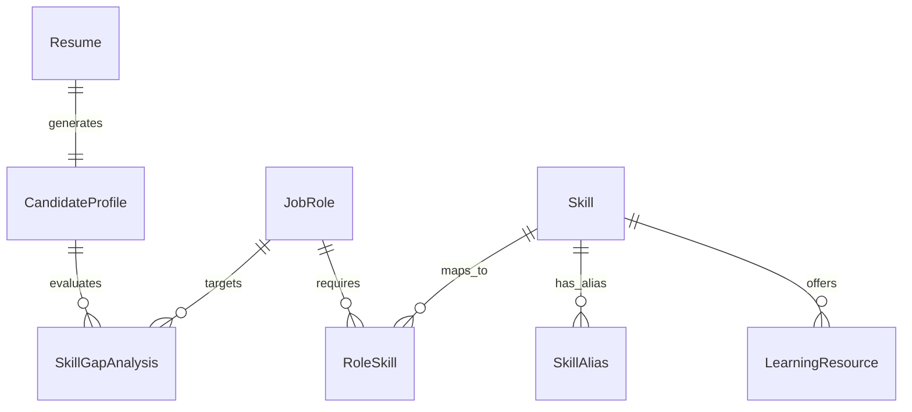

# Jobnity Platform — Technical Documentation & Architecture Guide

## 1. Executive Summary

**Jobnity** is an AI-powered career roadmap and skill gap analysis platform designed to bridge the gap between job seekers' current technical competencies and industry job role requirements. By parsing resumes (PDF/DOCX), extracting structured candidate profiles using a taxonomy-based NLP engine, and performing weighted skill gap analysis against benchmark job roles, Jobnity generates personalized, actionable learning roadmaps.

---

## 2. Platform Architecture & Tech Stack

```
+-----------------------------------------------------------------------+
|                              FRONTEND                                 |
|   React 18 + Vite | Framer Motion | Recharts | React Router v7     |
|   Custom Vanilla CSS Design System (Glassmorphic Dark Theme)          |
+-----------------------------------------------------------------------+
                                   |
                             HTTPS / REST API
                                   v
+-----------------------------------------------------------------------+
|                               BACKEND                                 |
|   Python 3 + FastAPI | Uvicorn ASGI Server | Pydantic v2              |
|   Resume Parser (pypdf + python-docx)                                 |
|   NLP Taxonomy & Skill Normalizer Service                             |
|   Weighted Skill Gap Analysis & Guardrail Engine                      |
+-----------------------------------------------------------------------+
                                   |
                            SQLAlchemy ORM
                                   v
+-----------------------------------------------------------------------+
|                               DATABASE                                |
|   SQLite (jobnity.db)                                                 |
|   Pre-seeded: 52 Job Roles | 1,156 Skills | 1,321 Skill Aliases        |
|               125 Learning Resources                                  |
+-----------------------------------------------------------------------+
```

### Technology Breakdown

| Component | Technology | Purpose |
| :--- | :--- | :--- |
| **Frontend UI** | React 18 + Vite | Fast, interactive single-page application (SPA). |
| **Styling & Motion** | Vanilla CSS + Framer Motion | Glassmorphic design, smooth UI transitions, responsive mobile/desktop views. |
| **Data Visualization** | Recharts | Interactive radar charts and skill breakdown graphs. |
| **Backend API** | Python 3 + FastAPI | High-performance asynchronous REST API. |
| **Database ORM** | SQLAlchemy | Unified database abstraction layer supporting SQLite and PostgreSQL. |
| **Document Processing**| `pypdf`, `python-docx` | Native text extraction from PDF and Word documents. |
| **Deployment** | Docker, Vercel, Cloudflare | Containerized runtime, serverless deployment, and secure tunneling. |

---

## 3. Data Model & Database Schema

The database consists of 8 core tables pre-populated from curated Kaggle industry datasets:



### Schema Overview

1. **`job_roles`**: 52 standardized industry roles (e.g. Data Scientist, DevOps Engineer, Full Stack Developer).
2. **`skills`**: 1,156 canonical technical skills categorized into Domains and Subdomains.
3. **`skill_aliases`**: 1,321 synonym and acronym mappings (e.g. `JS` -> `JavaScript`, `ReactJS` -> `React`).
4. **`role_skills`**: Skill mappings per job role with `importance` (`Required` vs `Preferred`), `priority` (1-5), and `minimum_level`.
5. **`learning_resources`**: 125 curated courses, documentation, and video links mapped to missing skills.
6. **`resumes`**: Stored upload metadata, file path, file type, and extracted raw text.
7. **`candidate_profiles`**: Parsed candidate entity records (Name, Contact, Education, Experience, Skills, Projects, Certifications).
8. **`skill_gap_analyses`**: Historical gap analysis records storing readiness score, skill gap score, matched skills, and missing skills.

---

## 4. Key Workflows & Engine Logic

### 4.1. Resume Parsing & NLP Skill Extraction

```
[Uploaded Resume] ──> [File Validation] ──> [Text Parser] ──> [NLP Section Splitter]
                                                                        │
[Candidate Profile] <── [Database Storage] <── [Taxonomy Matcher] <──────┘
```

1. **Validation**: Enforces file extensions (`.pdf`, `.docx`), MIME types, and file size (<10MB).
2. **Text Parsing**: `pypdf` extracts text from PDF page streams; `python-docx` extracts paragraphs and table cells.
3. **NLP Section Splitting**: Uses regex section headers to segregate `Header`, `Education`, `Experience`, `Skills`, `Projects`, and `Certifications`.
4. **Taxonomy & Alias Normalizer**:
   - Queries database canonical skills and aliases.
   - Sorts search terms by length descending to prevent substring collisions (e.g. `C` matching `C++` or `JS` matching `JSON`).
   - Applies regex word boundary matching (`\bterm\b`) to detect candidate skills with 100% accuracy.

### 4.2. Weighted Skill Gap Engine

When analyzing a candidate against a target role:

1. **User Skill Source of Truth**: Evaluates candidate skills confirmed during the profile review phase.
2. **Distinct Skill Guardrails**: Enforces non-equivalent skill boundaries to prevent false positives:
   - `Java` ≠ `JavaScript`
   - `Docker` ≠ `Kubernetes`
   - `AWS` ≠ `Azure`
   - `Python` ≠ `PyTorch`
   - `C` ≠ `C++` / `C#`
   - `React` ≠ `React Native`
   - `SQL` ≠ `NoSQL`
3. **Weighting Formula**:
   $$\text{Weight} = \text{Priority} \times (1.5 \text{ if Required else } 1.0)$$
   $$\text{Readiness Score (\%)} = \text{Round}\left( \frac{\sum \text{Earned Weights}}{\sum \text{Total Weights}} \times 100 \right)$$
   $$\text{Skill Gap Score (\%)} = 100 - \text{Readiness Score}$$

---

## 5. API Reference

All backend endpoints are prefixed with `/api`.

### Health & System
- `GET /api/health` — System health status.

### Resumes & Candidate Profiles
- `POST /api/resumes/upload` — Upload PDF/DOCX resume file & return extracted profile.
- `GET /api/resumes/{resume_id}/profile` — Retrieve parsed candidate profile.
- `PUT /api/resumes/{resume_id}/profile` — Update candidate profile (user skill confirmation).

### Job Roles & Taxonomy
- `GET /api/roles` — List all 52 benchmark job roles with category filtering.
- `GET /api/roles/{role_id}` — Get specific job role details and required skills.
- `GET /api/skills` — List canonical skill taxonomy.
- `GET /api/skills/search?q={query}` — Search skills and aliases.

### Analysis & Roadmaps
- `POST /api/analysis/skill-gap` — Perform weighted skill gap analysis for a candidate & role.
- `GET /api/analysis/{analysis_id}/recommendations` — Fetch learning resources & personalized roadmap steps for missing skills.

---

## 6. Deployment & Operations

### 6.1. Running via Docker

```bash
# Build and run unified frontend + backend container
docker compose up -d --build

# Container runs on port 8001
curl http://localhost:8001/api/health
```

### 6.2. Serverless Vercel Deployment

- Vercel root filesystem is read-only.
- `backend/app/core/config.py` detects serverless runtimes (`VERCEL=1`) and automatically copies `jobnity.db` to `/tmp/jobnity.db` and routes uploads to `/tmp/jobnity_uploads`.
- Handled via `api/index.py` and `vercel.json` rewrites.

### 6.3. Cloudflare Tunnel Setup

```bash
# Start tunnel routing https://jobnity.thundercipher.xyz to local container
cloudflared tunnel --config ~/.cloudflared/jobnity-config.yml run jobnity
```
