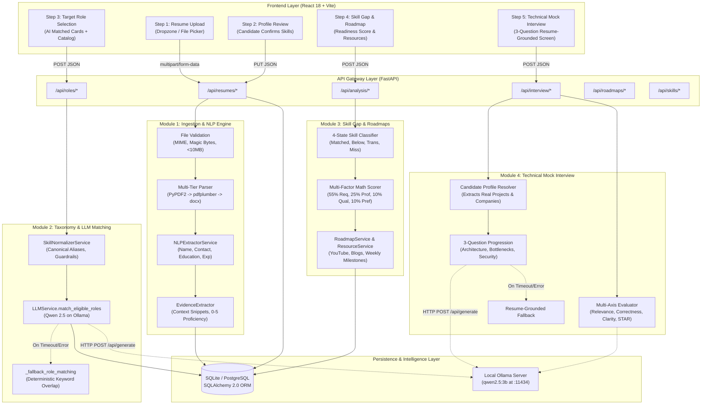
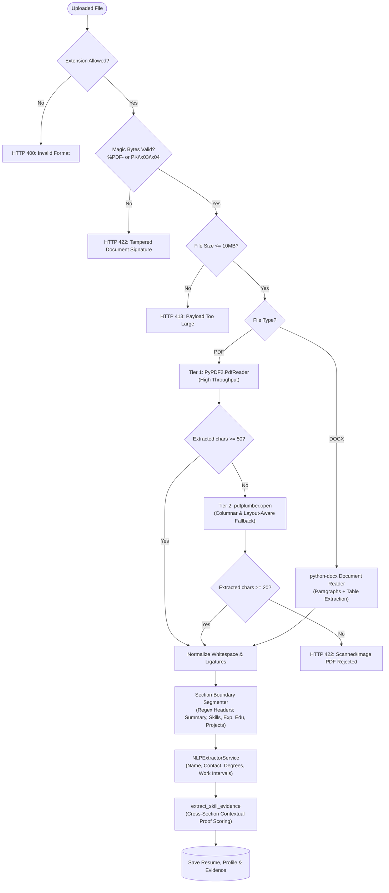
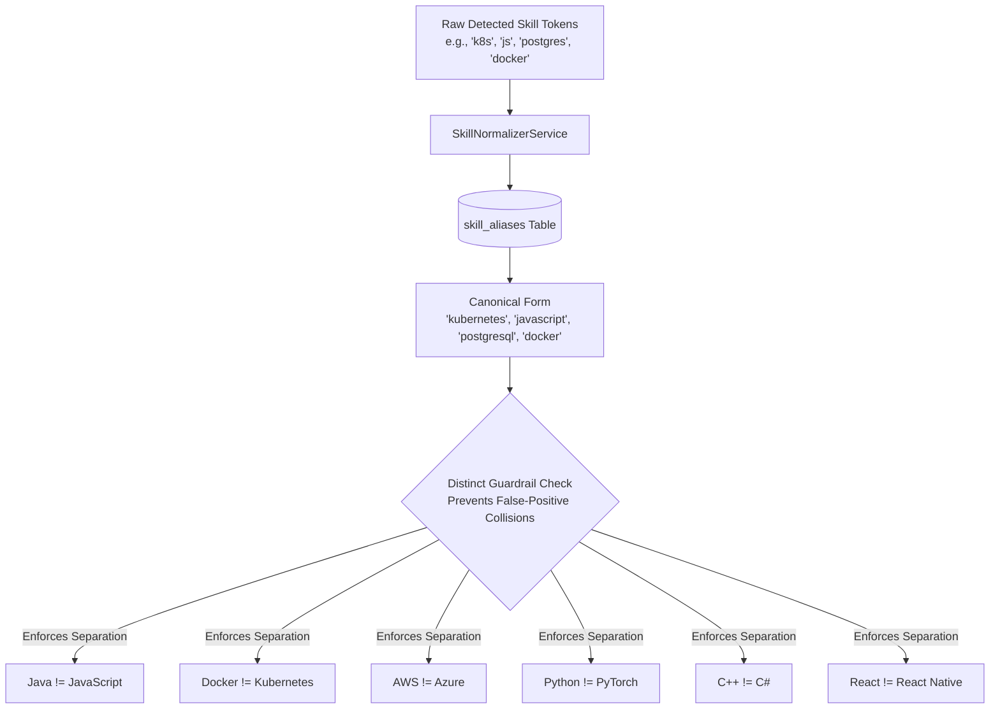
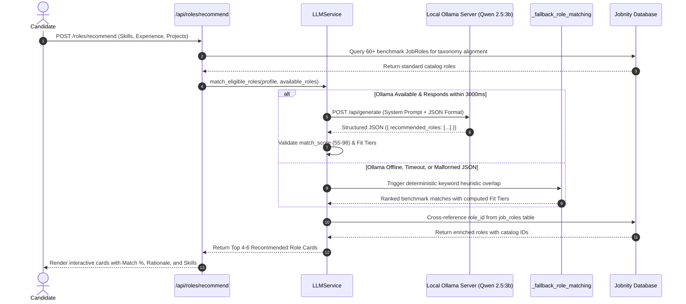
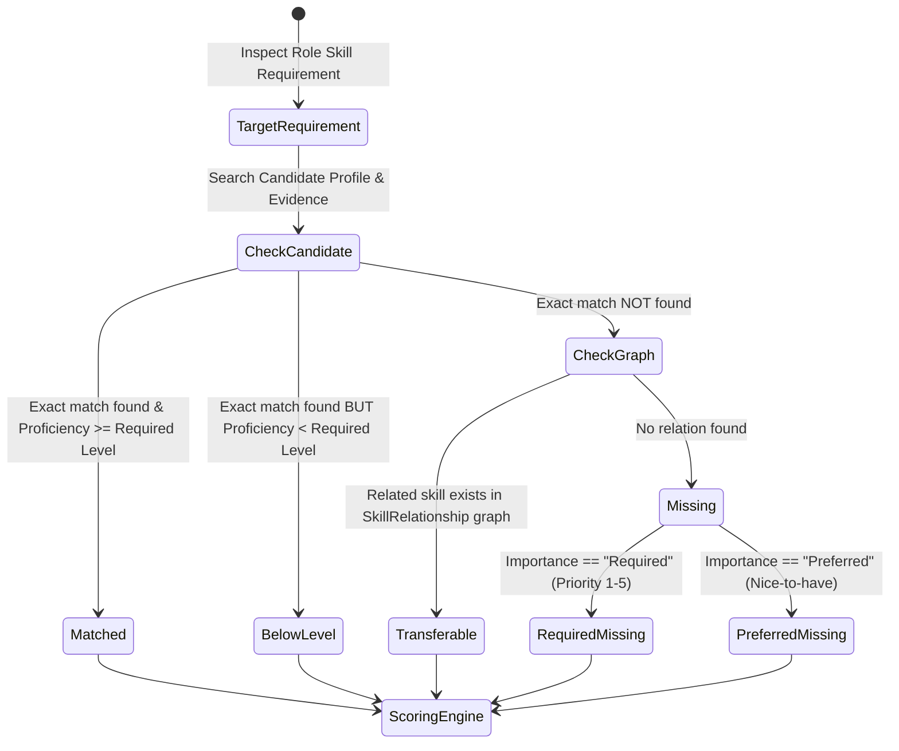
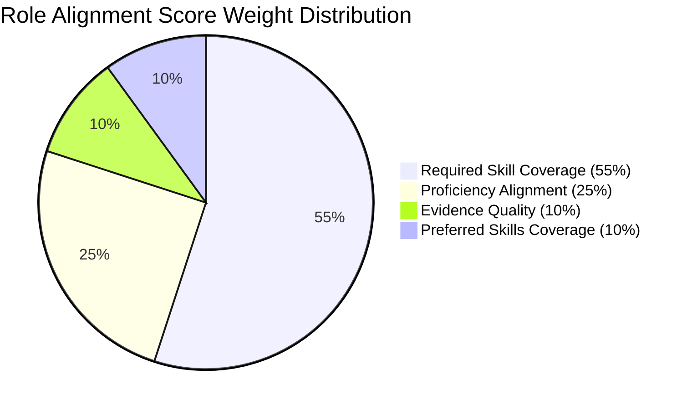
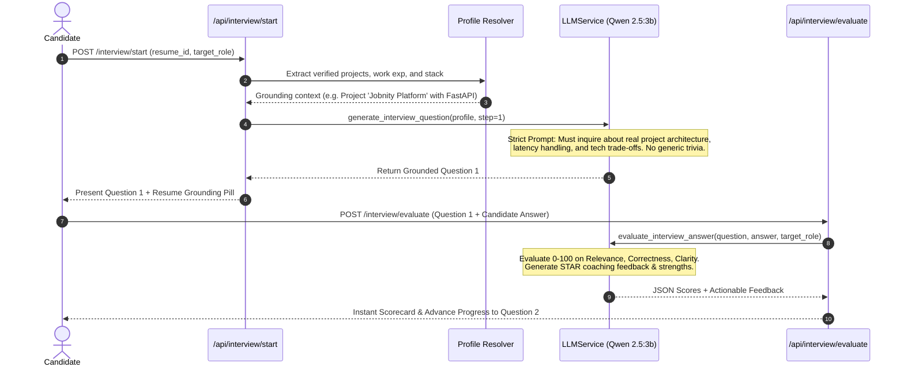
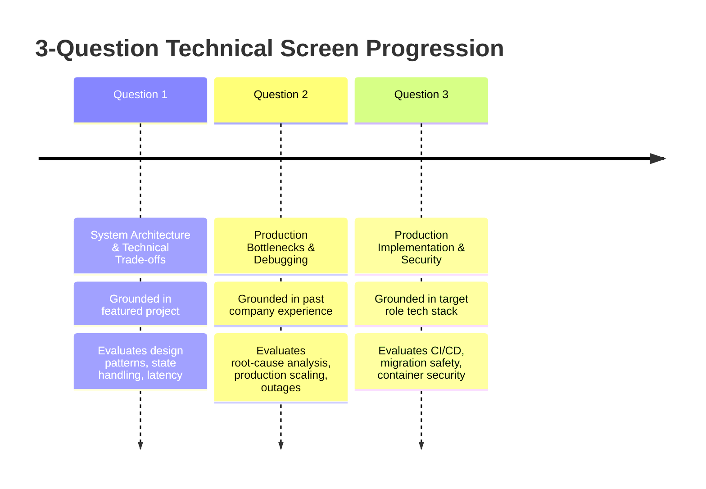
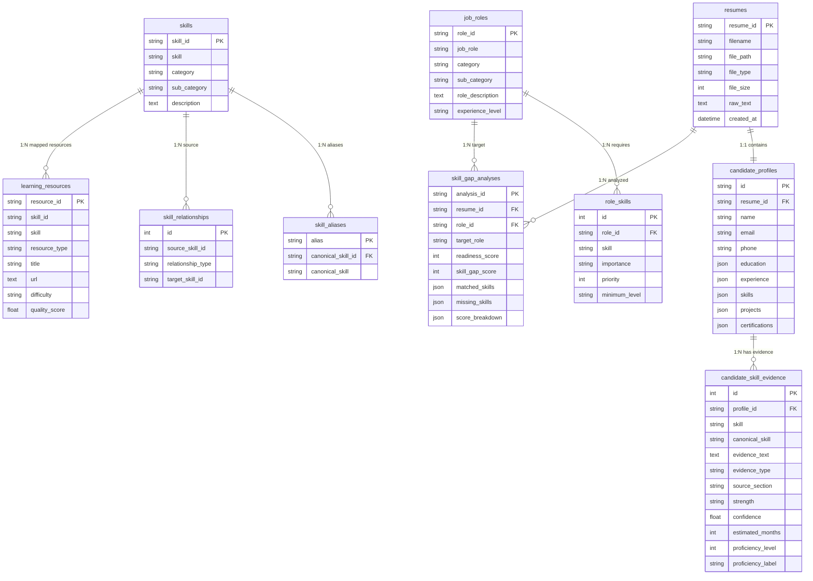

# Jobnity Backend Architecture & Technical Master Guide

> **Authoritative Technical Documentation**  
> **Platform Version**: 1.0.0  
> **Backend Engine**: FastAPI + SQLAlchemy + Local Qwen 2.5 (3B) on Ollama  
> **Verification Status**: 61/61 Pytest Suites Passing  

---

## 1. High-Level System Architecture

Jobnity is structured around four decoupled backend micro-services operating on a single unified asynchronous FastAPI runtime. The platform operates **100% locally with zero cloud dependencies**, ensuring candidate resume data never leaves the local machine.

### 1.1 Complete End-to-End Architectural Blueprint



---

## 2. Module 1: Resume Ingestion, Text Parsing & Evidence Extraction

Module 1 ingests unstructured binary documents (`.pdf`, `.docx`) and transforms them into verifiable, canonical candidate profiles.

### 2.1 Multi-Tier Parsing Flowchart



### 2.2 Skill Evidence Scoring & Proficiency Matrix

Unlike keyword scrapers that count word frequency, Jobnity validates **where and how** a skill was used in production:

```mermaid
flowchart LR
    subgraph EvidenceSources["Evidence Source Priority"]
        direction TB
        E1["1. Work Experience (Priority 5)\nProven Commercial Production"]
        E2["2. Certifications (Priority 4)\nAccredited Verification"]
        E3["3. Projects (Priority 3)\nHands-on Practical Application"]
        E4["4. Education (Priority 2)\nAcademic Foundation"]
        E5["5. Skills Section (Priority 1)\nSelf-declared Keyword"]
    end

    subgraph ProficiencyOutput["Proficiency Rating (0 - 5)"]
        direction TB
        L5["Level 5: Advanced (36+ Months in Work Exp + Action Verbs)"]
        L4["Level 4: Proficient (12 - 36 Months in Work Exp)"]
        L3["Level 3: Working (3 - 12 Months Exp OR Formal Certification)"]
        L2["Level 2: Basic (Explicitly in Projects or Skills Section)"]
        L1["Level 1: Mentioned (Incidental mention without context)"]
        L0["Level 0: No Evidence (Not found in resume)"]
    end

    EvidenceSources --> ProficiencyOutput
```



---

## 3. Module 2: Taxonomy Catalog & Local LLM Role Recommender

Module 2 maps candidate competencies against standardized industry tech roles.

### 3.1 Taxonomy Canonicalization & Distinct Guardrails



### 3.2 Role Recommender Dual-Engine Architecture



---

## 4. Module 3: Multi-Factor Skill Gap Engine & Curriculum Generator

Module 3 performs evidence-weighted mathematical gap analysis and builds structured roadmaps.

### 4.1 The 4-Way Skill Classification System



### 4.2 Multi-Factor Scoring Formula Breakdown

$$\mathbf{Role\ Alignment\ Score} = \left( 0.55 \cdot C_{\text{req}} + 0.25 \cdot P_{\text{align}} + 0.10 \cdot E_{\text{qual}} + 0.10 \cdot C_{\text{pref}} \right) \times 100 + B_{\text{trans}}$$



1. **Required Skill Coverage ($C_{\text{req}}$ - 55%)**: Ratio of required core skills satisfied ($\frac{\text{Required Matched}}{\text{Total Required}}$).
2. **Proficiency Alignment ($P_{\text{align}}$ - 25%)**: Average ratio of candidate proficiency vs required role seniority ($\frac{\text{Candidate Level}}{\text{Required Level}}$).
3. **Evidence Quality ($E_{\text{qual}}$ - 10%)**: Production validation factor (Strong = 1.0, Moderate = 0.65, Weak = 0.35).
4. **Preferred Skills Coverage ($C_{\text{pref}}$ - 10%)**: Extra credit for secondary capabilities.
5. **Transferable Bonus ($B_{\text{trans}}$)**: Up to $+5\%$ bonus credit for sister technologies mapped via the knowledge graph.

---

## 5. Module 4: Resume-Grounded Technical Mock Interview AI

Module 4 conducts dynamic technical screens strictly referencing real resume achievements.

### 5.1 Anti-Hallucination Grounding Workflow



### 5.2 The 3-Question Structured Progression



---

## 6. Complete Database Entity-Relationship Diagram (ERD)



---

## 7. Complete REST API Specifications

| Method | Endpoint | Description | Module |
| :--- | :--- | :--- | :--- |
| `POST` | `/api/resumes/upload` | Upload PDF/DOCX resume file & extract candidate profile | Module 1 |
| `PUT` | `/api/resumes/{resume_id}/profile` | Update and confirm candidate verified skills & details | Module 1 |
| `POST` | `/api/roles/recommend` | Recommend eligible job roles grounded in candidate resume via Qwen 2.5 | Module 2 |
| `GET` | `/api/roles` | List all 52 benchmark job roles with category and level filters | Module 2 |
| `GET` | `/api/roles/{role_id}` | Retrieve specific job role metadata & description | Module 2 |
| `GET` | `/api/roles/{role_id}/skills` | Get required and preferred skills for a specific job role | Module 2 |
| `GET` | `/api/skills` | Search standardized taxonomy skills | Module 2 |
| `POST` | `/api/analysis/skill-gap` | Execute multi-factor weighted skill gap analysis | Module 3 |
| `GET` | `/api/analysis/{analysis_id}/recommendations` | Get prioritized learning roadmaps and curated resources | Module 3 |
| `GET` | `/api/analysis/{analysis_id}/career-recommendations` | Get alternative career roles and high-leverage skills | Module 3 |
| `GET` | `/api/roadmaps/roles/{role_id}` | Retrieve weekly structured roadmap for a specific job role | Module 3 |
| `GET` | `/api/interview/status` | Check local Qwen 2.5 LLM connectivity and status | Module 4 |
| `POST` | `/api/interview/start` | Initialize 3-question screen & generate Question 1 grounded in resume | Module 4 |
| `POST` | `/api/interview/evaluate` | Evaluate candidate answer across Relevance, Correctness, and Clarity | Module 4 |
| `GET` | `/api/health` | Health check endpoint | System |

---

## 8. Verification & Test Execution

Run the complete backend test suite:
```bash
# Full test suite (61 tests)
python3 -m pytest backend/tests -v

# Run individual subsystem tests
python3 -m pytest backend/tests/test_api.py               # API Endpoints & Ingestion
python3 -m pytest backend/tests/test_scoring.py           # Multi-Factor Math Formula
python3 -m pytest backend/tests/test_proficiency.py       # Evidence & Proficiency Matrix
python3 -m pytest backend/tests/test_interview.py         # Grounded Interview & STAR Evaluation
python3 -m pytest backend/tests/test_name_extraction.py   # Name Heuristics
python3 -m pytest backend/tests/test_experience_extraction.py # Work Experience Parsing
python3 -m pytest backend/tests/test_education_extraction.py  # Degree & Academic Parsing
```
