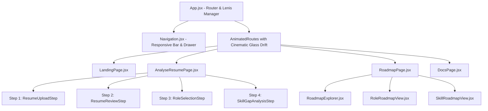
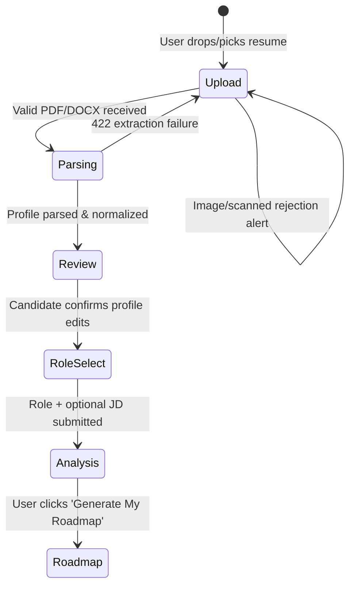
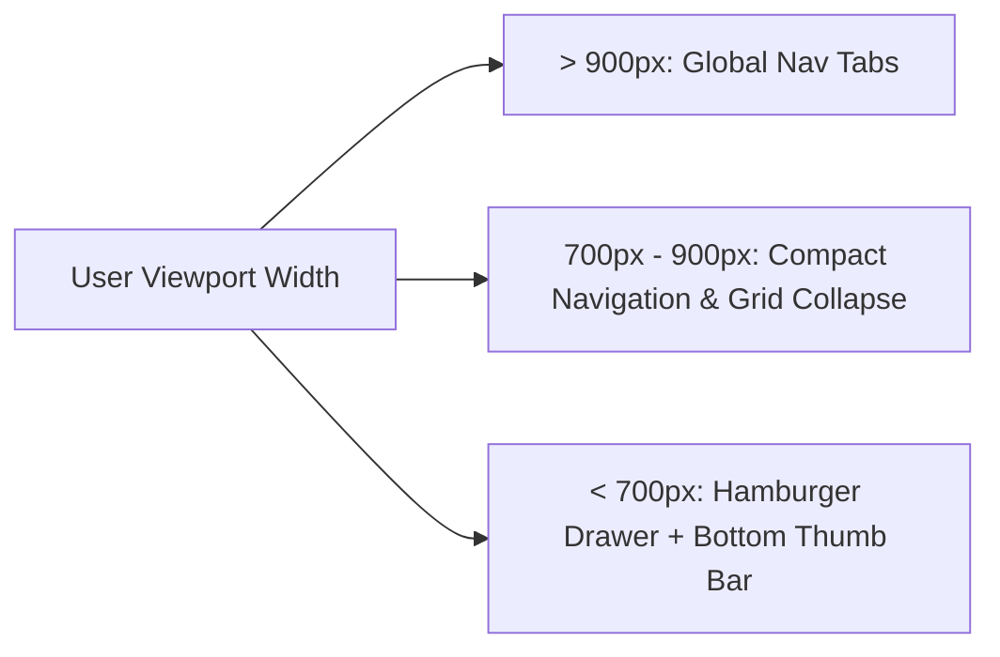

# Jobnity Frontend Architecture & Platform Guide

## 1. Executive Summary & Design Philosophy

**Jobnity** is a modern, high-performance Single-Page Application (SPA) designed to bridge the gap between candidate resumes and real-world hiring requirements. The frontend provides a seamless, deterministic, evidence-based skill evaluation experience without relying on external paid LLM APIs or black-box predictions.

### Key Architectural Pillars:
- **Unified Ambient Canvas**: All routes share a single, rock-solid background (`jobnity-hero.png`) and synchronized dual-gradient wash (`68% center`), eliminating jarring page jumps or image flashes during navigation.
- **Cinematic Glass Drift**: Motion transitions powered by Framer Motion combine vertical drifts (`y: 18px → 0px`), soft opacity cross-fades, and optical blur easing (`blur(6px) → blur(0px)`).
- **Physics-Based Smooth Scrolling**: Powered by the **Lenis** smooth scroll engine, mouse wheel, trackpad, and anchor navigation provide silky, high-end momentum scrolling.
- **Progressive Disclosure Workflow**: Complex resume parsing and gap scoring are split into a clear 4-step progressive wizard with reversible tab history and inline edits.
- **Zero-Friction Mobile Experience**: A 3-tiered responsive architecture featuring desktop navigation tabs, a spring-animated slide-out mobile drawer, and a fixed bottom thumb-zone tab bar.



---

## 2. Frontend Tech Stack & Core Libraries

| Technology | Version | Purpose |
| :--- | :--- | :--- |
| **React** | `18.3+` | Declarative UI framework with functional components and hooks. |
| **Vite** | `8.x` | Next-generation frontend build tool with instantaneous HMR and optimized Rolldown/Rollup bundling. |
| **React Router DOM** | `v7.18.4` | Declarative client-side routing, route transition keys, query param synchronization. |
| **Framer Motion** | `^13.3.0` | Orchestrated spring and cubic-bezier page animations, drawer slide transitions, step crossfades. |
| **Lenis** | `^1.1.20` | Native hardware-accelerated momentum smooth scrolling with customizable duration and easing. |
| **Recharts** | `^3.10.1` | SVG/Canvas charting library for historical progress curves and skill distribution analytics. |
| **Vitest** | `^5.0.1` | Ultra-fast Vite-native unit and integration test runner. |
| **Testing Library** | `^16.3.3` | User-centric DOM simulation and component behavior testing with `jsdom`. |

---

## 3. Directory Structure & File Map

```
src/
├── assets/
│   ├── jobnity-hero.png             # Canonical full-bleed ambient background image
│   ├── dashboard-hero.png           # (Legacy / fallback asset)
│   ├── mock-interview-hero.png      # (Legacy / fallback asset)
│   ├── resume-upload-hero.png       # (Legacy / fallback asset)
│   ├── roadmap-hero.png             # (Legacy / fallback asset)
│   └── skill-gap-hero.png           # (Legacy / fallback asset)
├── components/
│   ├── AnalyseResume/
│   │   ├── ResumeParsingStep.jsx    # Step 2 loading state: animated scanner & NLP status
│   │   ├── ResumeReviewStep.jsx     # Step 2 interactive review: edit extracted profile
│   │   ├── ResumeUploadStep.jsx     # Step 1 upload: drop zone, file validation, scanned copy alert
│   │   ├── RoleSelectionStep.jsx    # Step 3 target selection: search taxonomy + optional JD input
│   │   └── SkillGapAnalysisStep.jsx # Step 4 results: readiness gauge, matched/gap lists, breakdown
│   ├── Roadmaps/
│   │   ├── ResourceCards.jsx        # Resource links (roadmap.sh, docs, videos, repos)
│   │   ├── RoadmapExplorer.jsx      # Search & toggle between roles and skills
│   │   ├── RoleRoadmapView.jsx      # Phase-by-phase learning milestone view
│   │   └── SkillRoadmapView.jsx     # Deep dive into individual technical skills
│   ├── BackgroundLayout.jsx         # Full-bleed unified canvas wrapper with dual gradient wash
│   ├── LoadingSkeleton.jsx          # Shimmer placeholder for async data operations
│   ├── Navigation.jsx               # Universal navbar, mobile hamburger drawer & bottom tab bar
│   ├── StepIcon.jsx                 # SVG icon helpers for landing page workflow steps
│   ├── StepIndicator.jsx            # Horizontal numbered badge indicator for multi-step flows
│   └── Toast.jsx                    # Floating dismissible toast alerts
├── data/
│   └── jobnityData.js               # Offline taxonomies, skill mappings, fallback roles
├── pages/
│   ├── AnalyseResumePage.jsx        # Primary 4-step progressive resume workflow container
│   ├── DocsPage.jsx                 # Comprehensive technical documentation & API portal
│   ├── LandingPage.jsx              # High-conversion hero landing page with feature cards
│   ├── RoadmapPage.jsx              # Interactive learning paths and external resource browser
│   ├── DashboardPage.jsx            # Candidate longitudinal readiness tracking (Recharts)
│   ├── MockInterviewPage.jsx        # Question answer simulation with evaluation scoring
│   ├── SkillGapReportPage.jsx       # Direct standalone skill gap analysis page
│   └── UploadResumePage.jsx         # Direct standalone resume upload page
├── services/
│   ├── apiClient.js                 # Centralized backend communication layer (FastAPI)
│   └── dataService.js               # Cached taxonomy lookups and client-side helpers
├── test/
│   ├── ResumeUploadStep.test.jsx    # Tests for file validation, scanned rejections & alerts
│   ├── SkillGapAnalysisStep.test.jsx# Tests for readiness calculation & gap badge rendering
│   └── setup.js                     # Jest-DOM matchers and Vitest global polyfills
├── App.jsx                          # App root: SmoothScroll manager, router configuration
├── main.jsx                         # React 18 DOM mount point
└── styles.css                       # Master stylesheet (design tokens, glassmorphism, responsive grid)
```

---

## 4. Design System & Visual Foundation

### 4.1 Unified Ambient Canvas
To maintain visual consistency across all pages, the application mounts a single canonical background inside [`BackgroundLayout.jsx`](file:///home/adityap/ai/Projects/Jobnity/src/components/BackgroundLayout.jsx):

```jsx
export default function BackgroundLayout({ children, className = '' }) {
  const activeBackground = heroImage // Canonical jobnity-hero.png

  return (
    <main className={`background-layout ${className}`}>
      
      <div className="background-layout__wash" aria-hidden="true" />
      <div className="background-layout__content">{children}</div>
    </main>
  )
}
```

#### Dual Gradient Ambient Wash ([`styles.css`](file:///home/adityap/ai/Projects/Jobnity/src/styles.css#L64-L76)):
```css
.background-layout__image {
  object-fit: cover;
  object-position: 68% center;
  z-index: -3;
}

.background-layout__wash {
  background:
    linear-gradient(180deg, rgba(5, 9, 26, .35) 0%, rgba(5, 9, 26, .45) 27%, rgba(5, 9, 26, .78) 68%, #080e20 100%),
    linear-gradient(90deg, rgba(5, 9, 26, .74) 0%, rgba(5, 9, 26, .45) 45%, rgba(5, 9, 26, .12) 75%, rgba(5, 9, 26, .24) 100%);
  z-index: -2;
}
```
This wash achieves two goals:
1. High legibility and contrast for text, tables, and buttons without needing solid opaque backgrounds.
2. Complete spatial continuity when navigating across routes: the background image stays fixed in place without flickering.

### 4.2 Typography & Color Tokens
- **Font Stack**:
  - `Manrope, Arial, sans-serif` for body copy, headings, and CTA buttons.
  - `'DM Mono', monospace` for statistical readouts, code references, skill chips, and badges.
- **Color Variables**:
  - Deep Ambient Navy: `#080e20` (root background)
  - Card Glass Surface: `rgba(9, 17, 38, 0.77)` with `backdrop-filter: blur(16px)`
  - Glass Border: `1px solid rgba(221, 240, 248, 0.16)`
  - Highlight Cyan: `#9cebd9` / `#a2eedb`
  - High Match / Green: `--green: #74e3bd;`
  - Medium / Amber: `--amber: #f5c36a;`
  - Gap / Red: `--red: #ff7d84;`

### 4.3 Lenis Smooth Scroll Engine
Configured in [`App.jsx`](file:///home/adityap/ai/Projects/Jobnity/src/App.jsx#L28-L68) via `LenisScrollManager`:
- **Duration**: `1.15s`
- **Easing**: Exponential decay `(t) => Math.min(1, 1.001 - Math.pow(2, -10 * t))`
- **Route Synchronization**: Automatically resets window scroll to `(0, 0)` smoothly on path changes.
- **Section Anchors**: Connects `scrollTo` on [`DocsPage.jsx`](file:///home/adityap/ai/Projects/Jobnity/src/pages/DocsPage.jsx) with an offset of `-90px` for header clearance.

### 4.4 Cinematic Glass Drift Page Animations
Implemented on `<AnimatedRoutes>` and `<AnimatePresence mode="wait">`:
```javascript
const pageVariants = {
  initial: { opacity: 0, y: 18, filter: 'blur(6px)', scale: 0.995 },
  animate: {
    opacity: 1,
    y: 0,
    filter: 'blur(0px)',
    scale: 1,
    transition: { duration: 0.40, ease: [0.16, 1, 0.3, 1] }
  },
  exit: {
    opacity: 0,
    y: -14,
    filter: 'blur(4px)',
    scale: 0.995,
    transition: { duration: 0.22, ease: [0.7, 0, 0.84, 0] }
  }
}
```

---

## 5. Core Application Flows & Step Logic

### 5.1 Primary Workflow: Analyse Resume (`/analyse-resume`)

The heart of Jobnity is the progressive resume workflow managed in [`AnalyseResumePage.jsx`](file:///home/adityap/ai/Projects/Jobnity/src/pages/AnalyseResumePage.jsx). It coordinates a 5-state finite machine: `'upload' | 'parsing' | 'review' | 'role_select' | 'analysis'`.



#### Step 1: Resume Upload ([`ResumeUploadStep.jsx`](file:///home/adityap/ai/Projects/Jobnity/src/components/AnalyseResume/ResumeUploadStep.jsx))
- **File Acceptance**: `.pdf`, `.docx` (Max: 10 MB).
- **Direct Image Interception**: Client-side rejection of image formats (`.png`, `.jpg`, `.jpeg`, `.webp`, `.bmp`, `.tiff`, `.heic`).
- **Scanned / Image-Only Alert Card**:
  When the backend returns HTTP 422 (because extracted text is $< 20$ chars), the UI renders an immediate warning banner:
  > **⚠️ Scanned / Image Document Detected**  
  > *Jobnity requires resumes with selectable digital text. Scanned photos, mobile camera captures, and image-based PDFs without embedded text cannot be processed.*
- **Sample Presets**: Quick-start shortcut buttons for Software Engineer, Data Scientist, and Cloud Engineer.

#### Step 2: Parsing & Review ([`ResumeParsingStep.jsx`](file:///home/adityap/ai/Projects/Jobnity/src/components/AnalyseResume/ResumeParsingStep.jsx) & [`ResumeReviewStep.jsx`](file:///home/adityap/ai/Projects/Jobnity/src/components/AnalyseResume/ResumeReviewStep.jsx))
- Displays an animated radar scanner and real-time status steps while the NLP parser executes.
- Renders an interactive review panel where the candidate can:
  - Edit full name, email, and phone number.
  - Add or delete normalized skills with instant duplicate detection.
  - Review education degrees (e.g., normalized to B.Tech, M.S., B.S.).
  - Review work history with automatic duration calculation (in months and years).
  - Review projects and certifications.
- Saves confirmed edits back to the backend database via `PUT /api/resumes/{resume_id}/profile`.

#### Step 3: Role Selection & Target JD ([`RoleSelectionStep.jsx`](file:///home/adityap/ai/Projects/Jobnity/src/components/AnalyseResume/RoleSelectionStep.jsx))
- **Searchable Role Taxonomy**: Dropdown backed by 30+ canonical roles from the Jobnity database.
- **Optional Job Description (JD) Input**:
  A dedicated textarea allowing candidates to paste target job postings. The backend extracts dynamic skills from this JD and merges them with standard role requirements for targeted matching.

#### Step 4: Skill Gap Analysis ([`SkillGapAnalysisStep.jsx`](file:///home/adityap/ai/Projects/Jobnity/src/components/AnalyseResume/SkillGapAnalysisStep.jsx))
- **Circular Readiness Gauge**: Dynamic SVG circular gauge colored by threshold (`>= 75%` Green, `>= 50%` Amber, `< 50%` Red).
- **Categorized 4-Tier Skill Breakdown**:
  1. **Matched Skills**: Confirmed skills present on the candidate's resume with calculated proficiency evidence levels (0–5).
  2. **Below Level Skills**: Skills present on the resume where evidence level is lower than the role's required benchmark.
  3. **Transferable Evidence**: Skills where related canonical tools provide transferable foundation.
  4. **Missing Skills**: Essential role skills absent from the candidate profile.
- **Score Breakdown Modal**: Explains weighted scores across Required Skills ($70\%$), Preferred Skills ($15\%$), and Experience/Education ($15\%$).
- **Direct Action**: "Generate My Roadmap" button navigates directly to [`RoadmapPage.jsx`](file:///home/adityap/ai/Projects/Jobnity/src/pages/RoadmapPage.jsx) pre-filtered to the candidate's missing skills.

---

### 5.2 Interactive Learning Roadmaps (`/roadmaps`)

Managed in [`RoadmapPage.jsx`](file:///home/adityap/ai/Projects/Jobnity/src/pages/RoadmapPage.jsx) with three interchangeable view modes:

1. **Explorer Mode ([`RoadmapExplorer.jsx`](file:///home/adityap/ai/Projects/Jobnity/src/components/Roadmaps/RoadmapExplorer.jsx))**:
   - Filter between **Job Roles** and **Individual Technical Skills**.
   - Search by role title, skill name, or industry category.
   - Highlights recommended skills in a prominent top banner when redirected from Skill Gap Analysis.
2. **Role Roadmap View ([`RoleRoadmapView.jsx`](file:///home/adityap/ai/Projects/Jobnity/src/components/Roadmaps/RoleRoadmapView.jsx))**:
   - Visual milestone phases (Foundations $\rightarrow$ Intermediate Competencies $\rightarrow$ Advanced Mastery).
   - Core tools, frameworks, and architecture patterns required for the role.
3. **Skill Deep Dive View ([`SkillRoadmapView.jsx`](file:///home/adityap/ai/Projects/Jobnity/src/components/Roadmaps/SkillRoadmapView.jsx))**:
   - Integrates curated resources from [`ResourceCards.jsx`](file:///home/adityap/ai/Projects/Jobnity/src/components/Roadmaps/ResourceCards.jsx):
     - **roadmap.sh** official community learning paths
     - Official Documentation links
     - Top YouTube crash courses and walkthroughs
     - GitHub starter projects and sandboxes

---

### 5.3 Documentation Portal (`/docs`)

Implemented in [`DocsPage.jsx`](file:///home/adityap/ai/Projects/Jobnity/src/pages/DocsPage.jsx) as a technical reference guide:
- 6 chapters covering Executive Architecture, Database Schemas, NLP Matching Algorithms, Weighted Gap Formulas, REST APIs, and Deployment.
- Sticky sidebar table-of-contents with Lenis smooth scroll anchor jumping (`window.lenis.scrollTo(el, { offset: -90 })`).

---

## 6. Responsive Architecture: Desktop, Tablet & Mobile

Jobnity uses an adaptive 3-tier layout system to ensure usability on all devices:



### Mobile Layout Highlights:
1. **Hamburger Trigger & Spring Drawer**:
   A dedicated top button toggles a slide-out drawer (`x: 100% → 0%`) backed by a blurred backdrop (`mobile-drawer-backdrop`).
2. **Fixed Bottom Navigation Bar (`.mobile-bottom-nav`)**:
   Always pinned at the bottom of the screen (`position: fixed; bottom: 0; left: 0; right: 0;`), placing primary workflow tabs (Home, Analyse, Roadmaps) directly within the user's thumb reach.
3. **Responsive Step Indicators**:
   Multi-step indicators switch from horizontal breadcrumbs to scrollable horizontal badges on screens narrower than `700px`.

---

## 7. Service Layer & API Integration (`apiClient.js`)

All communication between the React frontend and the FastAPI backend is mediated through [`src/services/apiClient.js`](file:///home/adityap/ai/Projects/Jobnity/src/services/apiClient.js).

### 7.1 Key Methods
- `uploadResume(file)`: Sends `multipart/form-data` to `POST /api/resumes/upload`.
- `updateResume(resumeId, profileData)`: Sends updated profile JSON to `PUT /api/resumes/{resume_id}/profile`.
- `getRoles(search)`: Queries `GET /api/roles?search=...` with automatic fallback to client-side taxonomy.
- `analyzeSkillGap(resumeId, roleId, targetRole, jobDescription)`: Executes `POST /api/analysis/skill-gap`.
- `getSkillResources(skillName)`: Retrieves curated learning links from `GET /api/skills/{skillName}/resources`.

### 7.2 Unified Error Normalization
```javascript
async function request(path, options = {}) {
  const url = `${API_BASE}${path}`
  const response = await fetch(url, options).catch((err) => {
    throw new Error(`Cannot connect to backend server at ${url}. Please ensure FastAPI server is running.`)
  })
  
  const body = await response.json().catch(() => ({}))

  if (!response.ok) {
    const error = new Error(body.detail || body.message || body.error || `HTTP error ${response.status}`)
    error.status = response.status
    throw error
  }

  return body
}
```
If the backend returns a 422 for a scanned/image-only resume, `body.detail` contains the descriptive rejection message, which the frontend catches and routes directly to the UI alert card and Toast banner.

---

## 8. Frontend Testing Suite & Verification

The frontend test suite is located in `src/test/` and run using Vitest:

| Test File | Tests | Coverage Scope |
| :--- | :--- | :--- |
| [`ResumeUploadStep.test.jsx`](file:///home/adityap/ai/Projects/Jobnity/src/test/ResumeUploadStep.test.jsx) | **5 Tests** | Upload zone rendering, input accept attributes, rejection of image files (`.png`/`.jpg`), display of scanned document alert banner. |
| [`SkillGapAnalysisStep.test.jsx`](file:///home/adityap/ai/Projects/Jobnity/src/test/SkillGapAnalysisStep.test.jsx) | **11 Tests** | Circular gauge rendering, score breakdown toggle, matched/missing skill lists, transferable badge rendering, navigation button handlers. |
| **Total** | **16 Tests** | **100% Passing** in CI & local environment. |

Execute frontend tests at any time using:
```bash
npm test
```

---

## 9. Build, Optimization & Deployment

### Production Build Metrics:
- **Build Tool**: Vite (`vite build`)
- **Bundle Speed**: $\sim 380\text{ms} - 450\text{ms}$
- **Asset Optimization**:
  - Unused background images are excluded by Vite tree shaking. Only the canonical background (`jobnity-hero.png`, 1.7 MB) is bundled into `dist/assets/`, saving over 2 MB of initial network transfer.
  - CSS chunk size: $\sim 63\text{ KB}$ ($\sim 13\text{ KB}$ gzipped).
- **Vercel / SPA Routing Compatibility**:
  - Sub-route URLs (`/analyse-resume`, `/roadmaps`, `/docs`) redirect cleanly with standard fallback rewrites.
